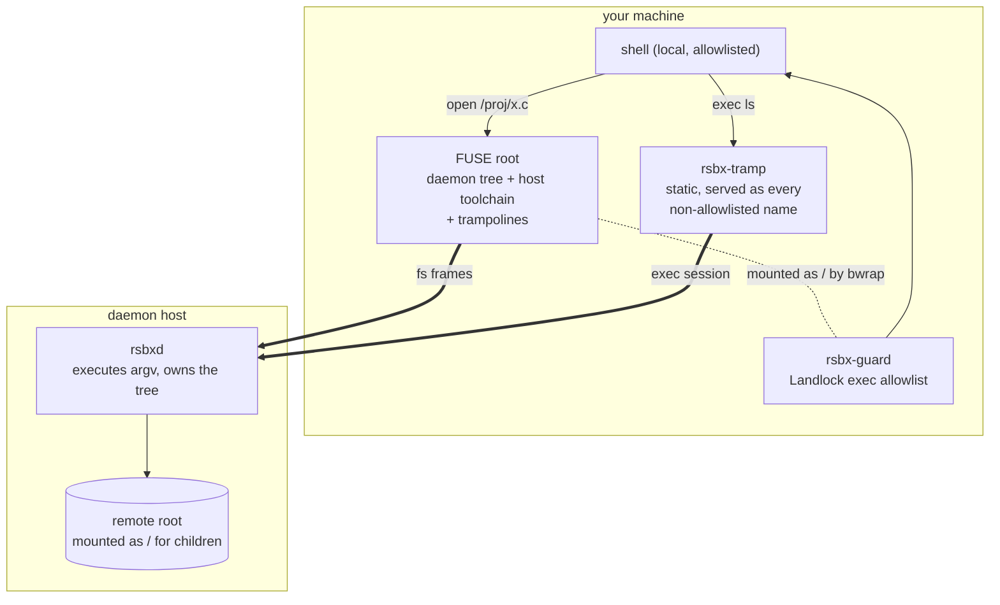

# rsbx — a shell whose world is the daemon's

`rsbx` gives you an interactive shell that behaves like an ssh session: the
filesystem you see, the processes you start, and the output you read all live
on a remote daemon. The exception is the list of programs in the configuration
file: those run **on your machine**, with the host toolchain and the host
kernel, but they still read and write the remote tree.

```
$ rsbx                       # drop into the sandbox shell
[rsbx] /proj $ git status    # git is local, the repo is remote
[rsbx] /proj $ make          # make is local, its children run remotely
```

## Two lists, two questions

**Where does it run?** Decided by `local.allow`, on the absolute path of the
executable.

**Whose files does it see?** Decided by `local.paths` and `local.read_only_paths`,
on the absolute path being opened.

The two lists are independent, and that is the point: a local program reads
both the local trees and (through the sandbox filesystem) the daemon tree,
while a program running on the daemon only ever sees the remote tree.

| program | runs on | sees |
|---|---|---|
| in `local.allow` | your machine | local trees, plus the daemon tree over FUSE |
| anything else | the daemon | only the daemon tree |
| path in `local.paths` | — | served from this machine, read/write |
| path in `local.read_only_paths` | — | served from this machine, read-only |
| any other path | — | answered by the daemon |

## How it is implemented



Three mechanisms, each independently sufficient for its own job:

1. **Trampolines.** The sandbox's `/usr/bin/ls` *is* a small static binary, not
   the host `ls`. Executing it asks the daemon to run `ls`. Because the host
   file is not reachable under that name at all, this works for statically
   linked programs and for execs that bypass libc.
2. **Union filesystem.** The sandbox root is a FUSE mount: paths the daemon
   owns are answered over the wire, host directories (`/usr/lib`, `/etc`, …)
   are served read-only, and executable names are resolved through the policy.
3. **Landlock (backstop).** `rsbx-guard` installs an exec allowlist inside the
   sandbox, so an exec that somehow skips the trampoline is refused by the
   kernel rather than silently running a host binary.

The daemon jails its children with bwrap so that `/` means the same thing on
both sides: a path you see in the sandbox is a path the daemon can open.

## The surprising part: `/` is the same on both sides

The client mounts the sandbox view at `~/.rsbx/sandbox`, then bwrap re-mounts
*that* as `/`. The daemon does the same with its root. Neither side translates
paths; a sandbox-absolute path is sent verbatim.

## Requirements

* Linux ≥ 5.13 for Landlock (older kernels degrade to trampoline-only).
* `bubblewrap`, `fusermount3`, unprivileged user namespaces.
* Go ≥ 1.24 to build.

## Build

```sh
go build -o rsbx       ./cmd/rsbx
go build -o rsbxd      ./cmd/rsbxd
CGO_ENABLED=0 go build -o rsbx-tramp ./cmd/rsbx-tramp
CGO_ENABLED=0 go build -o rsbx-guard ./cmd/rsbx-guard
```

Install all four in one directory; `rsbx` looks for its helpers next to
itself. `-ldflags "-X main.version=..."` stamps the client and the daemon.

## Container image

`Dockerfile` produces one image that carries both ends of the sandbox.

```sh
docker build -t rsbx .
docker run --rm -it --privileged -v /dev/fuse rsbx      # client
docker run --rm --entrypoint rsbxd -v /srv/tree:/tree rsbx \
  -socket /run/rsbx.sock -root /tree                     # daemon
```

The client needs `--privileged` (or `--cap-add SYS_ADMIN` plus an
unprivileged user namespace) and `/dev/fuse`: it mounts the sandbox root and
runs programs inside it. The daemon needs neither.

## CI

`.github/workflows/ci.yml` runs on every push and pull request:

| job | what it proves |
|---|---|
| `test` | gofmt, `go vet`, `go test -race ./...` |
| `binaries` | all four build statically and report a version |
| `docker` | the image builds, and a sandbox runs inside it end to end |

The last one is the only place the sandbox is actually exercised: it needs
`/dev/fuse` and a user namespace, which a bare runner does not provide. On
`main` the image is pushed to `ghcr.io/<owner>/rsbx`.

## Configuration notes

Two things that used to be configuration and no longer are:

* **The remote root is not a client setting.** It belongs to the daemon:
  `rsbxd -root /srv/tree`. A `[remote] table` is rejected with an error that
  says so, because accepting it silently did nothing.
* **`sandbox.cache` is a cache, not a shared tree.** It holds copies of remote
  files this machine has read, keyed by the daemon's metadata; an entry is used
  only while that metadata still matches, so a file changed on the daemon is
  refetched instead of served stale. Deleting the directory costs bandwidth and
  nothing else.

## Tests

```sh
go test ./...
```

The suite pins the decisions that are easy to get silently wrong: which paths
are local, that a bind never shadows an exec directory, that the dynamic loader
is never turned into a trampoline, and that the daemon never lets a path escape
its root.

## Run

```sh
rsbxd -socket ~/.rsbx/daemon.sock -root ~/remote-tree &   # on the daemon host
rsbx -config ~/.rsbx/config.toml                          # on your machine
```

Use `rsbx -no-mount` to print the resolved plan (allowlist, mount, bwrap
arguments) without starting anything.

## Limits worth knowing

* **Writes are whole-file.** Edits land on `close`/`release`; there is no byte
  range protocol yet, so very large remote files are copied in full.
* **Metadata is cached.** Lookups are answered from the daemon with a short
  TTL; a file changed on the daemon may stay stale for that window.
* **Landlock needs a recent kernel.** On older kernels the trampoline is the
  only guard, and a program that calls `execve` by raw syscall on a host path
  outside the FUSE root could still run locally.
* **The daemon trusts the client.** It executes whatever argv it receives;
  it is a remote shell, not a multi-tenant service.

## Running coding agents inside the sandbox

An agent is an ordinary local program as far as the sandbox is concerned, with
two consequences worth knowing before configuring one.

**The agent must be on `local.allow`.** It keeps its own state, so it belongs on
this machine. Anything else runs on the daemon, where `/work` does not exist.

**The tools a redirected command needs must be local too.** This is the part
that surprises people: `ls`, `stat` and `cat` are not special. If they are not
allowed locally they run on the daemon, and a daemon-side `stat` of a local
tree reports `No such file or directory`. Listing the coreutils you use is what
makes an agent's own file inspection work:

```toml
[local]
allow = ["/usr/bin/bash", "/usr/bin/ls", "/usr/bin/stat", "/usr/bin/cat",
         "/usr/bin/grep", "/usr/bin/find", "/usr/bin/wc", "/usr/bin/mkdir",
         "/usr/bin/timeout", "/usr/local/bin/codex", "/usr/local/bin/claude"]
paths = ["/work", "/home/me/.codex", "/home/me/.claude"]
```

The same rule explains the small warning a static agent may print on start-up:
a redirected helper fails, and the agent continues without it.

Redirection is deliberately limited to the directories where the allowlist
lives. A data file that merely has the execute bit set — a script in a project
tree, a `chmod +x` text file — passes through untouched, so an agent reading its
own files never receives the trampoline by accident.

Verified in the container image, with the daemon serving a remote tree:

```console
=== agents reachable and local ===
320186856 /e2e/agents/codex
=== codex runs ===
codex-cli 0.167.1
=== agent sees the REMOTE project ===
README.md calc.py
=== agent writes to the remote tree ===
written-by-agent
```

The agent binary is the host file (its real size), the project it edits is the
daemon's, and the write lands in the daemon tree.

An agent that is dynamically linked against a libc the image does not ship
cannot start, whatever the sandbox does about it: the failure is
`cannot execute: required file not found`, reported by the kernel when the ELF
interpreter is missing. That is a packaging property of the agent, not a
sandbox setting.
