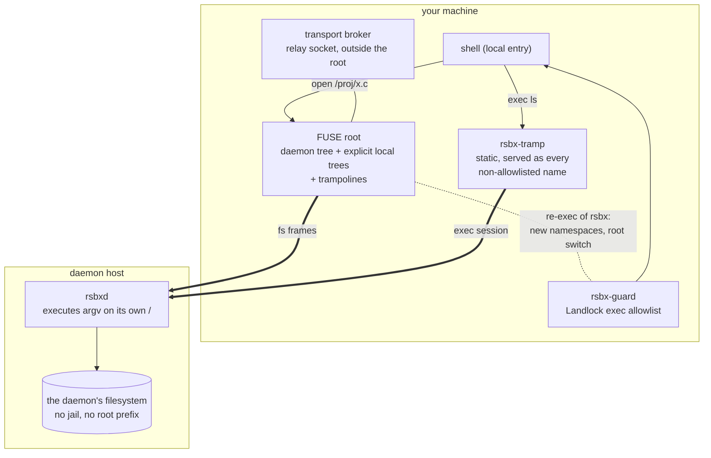

# rsbx — a shell whose world is the daemon's

`rsbx` gives you an interactive shell that behaves like an ssh session: the
filesystem you see, the processes you start, and the output you read all live
on a remote daemon. There is no daemon jail and no root to configure: the
daemon executes on its own machine, and **its `/` is the remote filesystem**.
A path you see in the sandbox is a path the daemon can open, sent verbatim.

The one exception is the short list of programs you deliberately run **on your
machine**, with the host toolchain and the host kernel, while they still read
and write the remote tree through the sandbox filesystem.

```
$ rsbx                       # drop into the sandbox shell
[rsbx] /proj $ git status    # git runs remotely, in the daemon's /proj
[rsbx] /proj $ make          # make and its children run on the daemon
```

## Two lists, two questions

**Where does it run?** Decided by `local.allow`, on the absolute path of the
executable. The default is empty: only `local.entry` (`/bin/sh`) runs locally.
Every other command — including `ls`, `cat` and a coding agent you did not
list — executes on the daemon. Nothing about `/usr/bin` or a library tree is
implicitly local.

**Whose files does it see?** Decided by `local.paths` and
`local.read_only_paths`, on the absolute path being opened. Both default to
empty: outside an explicit local tree, the client's ordinary filesystem
answers come from the daemon, and the only host bytes that may be read are the
allowed executable itself.

The two lists are independent, and that is the point: a local program reads
both the local trees and (through the sandbox filesystem) the daemon tree,
while a program running on the daemon only ever sees the native remote tree.

| program | runs on | sees |
|---|---|---|
| `local.entry` | your machine | local trees, plus the daemon tree over FUSE |
| in `local.allow` | your machine | local trees, plus the daemon tree over FUSE |
| anything else | the daemon | the daemon's own filesystem, native paths |
| path in `local.paths` | — | served from this machine, read/write |
| path in `local.read_only_paths` | — | served from this machine, read-only |
| any other path | — | answered by the daemon |

## How it is implemented



Four mechanisms, each independently sufficient for its own job:

1. **Native daemon view.** `rsbxd` runs commands directly on the machine it
   runs on. There is no `-root`, no alternate root, no mount jail: the daemon's
   working directory, `/proc`, `/dev` and the project tree are its own. That is
   why no path translation exists anywhere in the system.
2. **Trampolines.** The sandbox's `/usr/bin/ls` *is* a small static binary, not
   the host `ls`. Executing it asks the daemon to run `ls`. Because the host
   file is not reachable under that name at all, this works for statically
   linked programs and for execs that bypass libc.
3. **Union filesystem.** The sandbox root is a FUSE mount: paths not claimed by
   an explicit local tree are answered over the wire by the daemon, and
   executable names are resolved through the policy.
4. **Landlock (backstop).** `rsbx-guard` installs an exec allowlist inside the
   sandbox, so an exec that somehow skips the trampoline is refused by the
   kernel rather than silently running a host binary.

The client enters its own fixed layout without an external helper: it
re-executes itself before ordinary CLI parsing, asks the kernel for new user,
mount and pid namespaces, mounts the FUSE root, switches root and detaches the
old one, then drops inherited descriptors. Mount isolation is mandatory and
fails closed.

### The local runtime, and what is *not* local

Inside that layout, `/proc` and a minimal `/dev` are **kernel facilities** of
the client's own namespaces — not daemon content, and not overrides of daemon
files. They are documented here precisely because they are the one part of `/`
that does not come over the wire.

Everything else is explicit:

* no private `/tmp`: `/tmp` is whatever the daemon says it is;
* no implicit `/etc`, `/usr/lib`, `/lib`, `/lib64` or merged-`/usr` host
  symlinks;
* no host `$HOME/.ssh` and no automatic SSH binary: the SSH client and the
  credentials used by the `ssh` transport stay outside the sandbox, and only a
  private relay socket is bound at the reserved `/.rsbx-rpc`.

A local program's own shared objects are mapped at exec time through the
sandbox, because the loader runs then; that is the executable bytes the policy
allows, not arbitrary host data that merely sits next to it.

## Requirements

* Linux ≥ 5.13 for Landlock (older kernels degrade to trampoline-only).
* `fusermount3` and unprivileged user namespaces.
* No external sandbox helper: bubblewrap is not used and not needed.
* Go ≥ 1.24 to build.

## Build

```sh
go build -o rsbx       ./cmd/rsbx
go build -o rsbxd      ./cmd/rsbxd
CGO_ENABLED=0 go build -o rsbx-tramp ./cmd/rsbx-tramp
CGO_ENABLED=0 go build -o rsbx-guard ./cmd/rsbx-guard
```

Install all four in one directory; `rsbx` looks for its helpers next to
itself. `-ldflags "-X main.version=..."` stamps the client and the daemon.

## Container image

`Dockerfile` produces one slim image that carries both ends of the sandbox.
There is no bubblewrap, no compiler and no bundled libc or model runtime.

```sh
docker build -t rsbx .

# daemon: its own disposable container; /proj is mounted from a throwaway
# volume and served exactly as it is, native paths, no root argument
docker run --rm --name rsbxd -v proj-vol:/proj -v rsbx-run:/run/rsbx \
  --entrypoint rsbxd rsbx -socket /run/rsbx/daemon.sock

# client: privileged only for /dev/fuse and the user namespace; it mounts no
# project and no /usr tree, just the socket volume and its own scratch state
docker run --rm -it --privileged -v /dev/fuse -v rsbx-run:/run/rsbx \
  -v rsbx-home:/home/rsbx rsbx
```

The client needs `--privileged` (or `--cap-add SYS_ADMIN` plus an
unprivileged user namespace) and `/dev/fuse`: it mounts the sandbox root and
runs programs inside it. It never binds the project directory: `/proj` exists
only in the daemon container, and the client sees it through rsbx, the way it
would over ssh. The daemon needs neither privilege nor `/dev/fuse`, and it
takes no root argument: whatever is mounted at `/proj` in its container *is*
`/proj` for the programs it runs.

The two ends are separate disposable containers sharing a socket volume; see
CI below.

## CI

`.github/workflows/ci.yml` runs on every push and pull request:

| job | what it proves |
|---|---|
| `test` | gofmt, `go vet`, `go build`, `go test -race ./...` |
| `binaries` | all four build statically and report a version |
| `docker` | the image builds, a real FUSE mount passes the filesystem tests, and a client drives a daemon in a **separate disposable container** whose `/proj` is a mounted test volume |

The last job is the only place the sandbox is actually exercised end to end.
It starts `rsbxd` in its own disposable container with a test volume mounted
at `/proj` and a socket volume shared with the client, waits for the socket,
then runs the client in a second container: privileged for `/dev/fuse` and the
user namespace, with no bind of the project tree — the client's only view of
`/proj` is the one the daemon serves.

On `main` the image is pushed to `ghcr.io/<owner>/rsbx`.

## Configuration notes

Three things that used to be configuration and no longer are:

* **The daemon root is not a client setting and not a daemon flag.** `rsbxd`
  runs on its own host; its filesystem is the remote tree. A `[remote]` table
  is rejected with an error that says so, because there is no root to pass.
* **No implicit local tree.** `local.allow` defaults to empty (the entry shell
  is local by definition), and `local.paths` / `local.read_only_paths` default
  to empty. Listing `/usr/bin`, `/lib` or `/etc` is a deliberate choice, never
  a default.
* **`sandbox.cache` is disposable runtime scratch.** The client and its helpers
  stage transient data there. It is not a snapshot of remote files and nothing
  is ever served from it: deleting the directory costs the client re-staging,
  never correctness.

## Tests

```sh
go test ./...
```

The suite pins the decisions that are easy to get silently wrong: which paths
are local, that the default allowlist is only the entry shell, that a script in
a project tree is never turned into a trampoline, and that daemon paths are
native absolute paths.

## Run

```sh
rsbxd -socket ~/.rsbx/daemon.sock &    # on the daemon host
rsbx -config ~/.rsbx/config.toml       # on your machine
```

Use `rsbx -no-mount` to print the resolved plan (allowlist, mount arguments,
namespace plan) without starting anything.

## Limits worth knowing

* **Metadata is cached briefly.** Lookups are answered by the daemon with a
  short TTL; a file changed on the daemon may stay stale for that window. Data
  is never cached: opens get real daemon descriptors.
* **Landlock needs a recent kernel.** On older kernels the trampoline is the
  only guard, and a program that calls `execve` by raw syscall on a host path
  outside the FUSE root could still run locally.
* **The daemon trusts the client.** It executes whatever argv it receives;
  it is a remote shell, not a multi-tenant service.

## Running coding agents inside the sandbox

An agent is an ordinary local program as far as the sandbox is concerned, with
two consequences worth knowing before configuring one.

**The agent must be listed in `local.allow`.** It keeps its own state, so it
belongs on this machine. Anything else runs on the daemon, under the daemon's
own filesystem.

**A tool belongs on the list only if it must read local content.** The default
is remote execution, and that is the cheaper path. A tool that runs on the
daemon cannot see a `local.paths` tree, since the two sides have different
filesystem views. When such a command fails, the sandbox names the cause
rather than leaving a bare `ENOENT`:

```
rsbx: stat ran on the daemon and cannot see the local tree /work/a.txt;
      add /usr/bin/stat to local.allow to run it here instead
```

A minimal agent setup lists the agent, the helpers it needs locally, and the
directories it reads:

```toml
[local]
allow = ["/usr/local/bin/codex", "/usr/local/bin/claude"]
paths = ["/opt/agents",          # where it lives
         "/home/me/.codex",      # and what it reads
         "/home/me/.claude"]
entry = "/bin/sh"
```

Everything else — `/usr`, the project tree, the rest of the host — is answered
by the daemon. The project path itself is the daemon's absolute path: an agent
told to work in `/proj` opens `/proj` on the daemon, not a translated copy.

Redirection is deliberately limited to the directories where the allowlist
lives. A data file that merely has the execute bit set — a script in a project
tree, a `chmod +x` text file — passes through untouched, so an agent reading its
own files never receives the trampoline by accident.

Verified with a separate daemon container serving its own `/proj` — the agent
binary is local, everything it does to the project is a daemon-side write:

```console
=== agent reachable and local ===
320186856 /e2e/agents/codex
=== codex runs ===
codex-cli 0.167.1
=== agent sees the REMOTE project ===
README.md calc.py
=== agent writes to the remote tree ===
written-by-agent
```

The agent binary is the host file (its real size), the project it edits is the
daemon's `/proj`, and the write lands on the daemon's disk — checked through a
session, since the client container never mounted the project.

The sandbox does not paper over a packaging problem: an agent that is
dynamically linked against a libc neither side ships cannot start, and the
kernel reports `cannot execute: required file not found` when the ELF
interpreter is missing. That is a property of the agent binary and its image,
not a sandbox setting, and there is no runtime shim for it.
