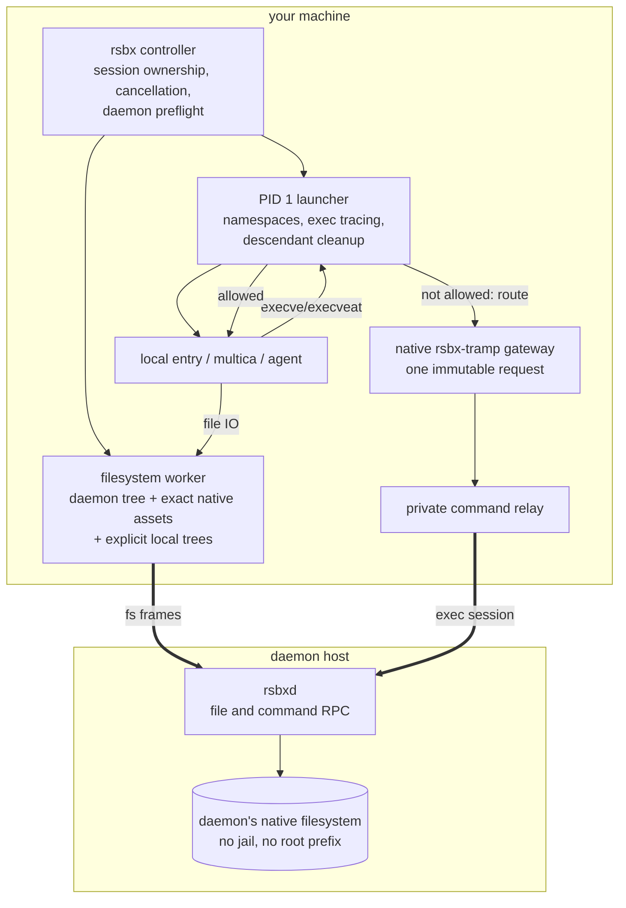

# rsbx — a shell whose world is the daemon's

`rsbx` gives you an interactive shell that behaves like an ssh session: the
filesystem you see, the processes you start, and the output you read all live
on a remote daemon. There is no daemon jail and no root to configure: the
daemon executes on its own machine, and **its `/` is the remote filesystem**.
A path you see in the sandbox is a path the daemon can open, sent verbatim.

The one exception is the short list of programs you deliberately run **on your
machine**, with the host toolchain and the host kernel, while they still read
and write the remote tree through the sandbox filesystem.

```
$ rsbx                       # drop into the sandbox shell
[rsbx] /proj $ git status    # git runs remotely, in the daemon's /proj
[rsbx] /proj $ make          # make and its children run on the daemon
```

## Two lists, two questions

**Where does it run?** Decided by `local.allow`, on the absolute path of the
executable. The default is empty: only `local.entry` (`/bin/sh`) runs locally.
Every other command — including `ls`, `cat` and a coding agent you did not
list — executes on the daemon. A directory or glob allow entry is expanded
once into an exact startup snapshot of the executables that exist then; it is
not a prefix grant for code created later.

**Whose files does it see?** Decided by `local.paths` and
`local.read_only_paths`, on the absolute path being opened. Both default to
empty: outside an explicit local tree, ordinary filesystem answers come from
the daemon. Exact selected programs and their verified runtime dependencies
are read-only host exceptions.

The two lists are independent, and that is the point: a local program reads
both the local trees and (through the sandbox filesystem) the daemon tree,
while a program running on the daemon only ever sees the native remote tree.

| program | runs on | sees |
|---|---|---|
| `local.entry` | your machine | local trees, plus the daemon tree over FUSE |
| in `local.allow` | your machine | local trees, plus the daemon tree over FUSE |
| anything else | the daemon | the daemon's own filesystem, native paths |
| path in `local.paths` | — | served from this machine, read/write |
| path in `local.read_only_paths` | — | served from this machine, read-only |
| any other path | — | answered by the daemon |

## How it is implemented



Six mechanisms, each with one owner:

1. **Native daemon view.** `rsbxd` runs commands on its own machine. There is
   no root rewrite or mount jail: its `/proj` is the project tree.
2. **Immutable file sources.** A FUSE inode's source is chosen when it is
   resolved: daemon bytes, one exact native executable/runtime asset, or an
   explicit local tree. Project executables and project `.so` files stay
   remote bytes; reading them never substitutes a helper.
3. **Exec supervision.** The namespace's PID 1 traces `execve`/`execveat` for
   every descendant, including PATH, absolute, relative and project paths.
   An exact compiled local asset runs here; every other named executable is
   handed to a native gateway. Landlock refuses any remaining direct path.
4. **Verified local runtime.** A locally selected program runs from a
   controller-pinned immutable snapshot with the interpreter and library
   dependencies compiled for it. Runtime paths are dependencies, never a
   separate command allowlist.
5. **Private command gateway.** An intercepted remote exec carries target,
   argv, cwd, environment, TTY, signals and exit status to the daemon. The
   supervisor authenticates the gateway process; argv[0] cannot replace the
   executable target.
6. **Owned lifecycle.** Every invocation owns its mount, cache, broker,
   connections and process tree. Cancellation closes those resources first;
   PID 1 kills and reaps traced descendants, including children that changed
   process groups.

### The local runtime, and what is *not* local

Inside that layout, `/proc` and a minimal `/dev` are **kernel facilities** of
the client's own namespaces — not daemon content, and not overrides of daemon
files. They are documented here precisely because they are the one part of `/`
that does not come over the wire.

Everything else is explicit:

* no private `/tmp`: `/tmp` is whatever the daemon says it is;
* no implicit host directory tree: only exact runtime assets and their
  structural aliases are compiled for the selected local programs;
* no host `$HOME/.ssh` and no automatic SSH binary: the SSH client and the
  credentials used by the `ssh` transport stay outside the sandbox, and only a
  private relay socket is bound at the reserved `/.rsbx-rpc`.

ELF interpreters, shared libraries and shebang interpreter chains are resolved
before startup. Unresolvable assets fail explicitly. Extra package data and
dynamic plugins require explicit read-only resource paths; runtime dependencies
do not authorize independent interpreter invocations.

## Requirements

* Linux ≥ 5.13 for Landlock and the architecture's ptrace exec tracing on
  amd64/arm64. There is no silent weaker execution mode.
* `fusermount3` and the required mount/PID namespaces; nested user namespaces
  can be disabled explicitly inside an existing container user namespace.
* Go ≥ 1.24. Build client, daemon and helpers together: execution wire version
  2 separates the executable target from argv[0] and rejects old records.

## Build

```sh
go build -o rsbx       ./cmd/rsbx
go build -o rsbxd      ./cmd/rsbxd
CGO_ENABLED=0 go build -o rsbx-tramp ./cmd/rsbx-tramp
CGO_ENABLED=0 go build -o rsbx-guard ./cmd/rsbx-guard
```

Install all four in one directory; `rsbx` looks for its helpers next to
itself. `-ldflags "-X main.version=..."` stamps the client and the daemon.

## Container image

`Dockerfile` produces one image that carries both ends of the sandbox.

```sh
docker build -t rsbx .
docker run --rm -it --privileged -v /dev/fuse rsbx             # client
docker run --rm --entrypoint rsbxd -v /srv/tree:/proj rsbx \
  -socket /run/rsbx/daemon.sock                                # daemon
```

The client needs `--privileged` (or `--cap-add SYS_ADMIN` plus an unprivileged
user namespace) and `/dev/fuse`: it mounts the sandbox root and runs programs
inside it. The daemon needs neither.

The two ends are separate disposable containers sharing a socket volume; see
CI below.

## CI

`.github/workflows/ci.yml` runs on every push and pull request:

| job | what it proves |
|---|---|
| `test` | gofmt, `go vet`, `go build`, `go test -race ./...` |
| `binaries` | all four build statically and report a version |
| `docker` | the image builds, a real FUSE mount passes the filesystem tests, a client drives a daemon in a **separate disposable container** whose `/proj` is a mounted test volume, and the mixed-placement stand-ins pass: 11 lab checks, 4 stress checks at N concurrent sessions on one shared configuration |

The `docker` job is the only place the sandbox is exercised end to end. It
starts `rsbxd` in its own disposable container with a test volume mounted at
`/proj` and a socket volume shared with the client, waits for the socket, then
runs the client in a second container: privileged for `/dev/fuse` and the user
namespace, with no bind of the project tree — the client's only view of
`/proj` is the one the daemon serves.

The mixed-placement scripts in `testdata/mixed` drive shell stand-ins for the
agent CLIs. That gate measures placement and file-source policy; it is not a
real-agent compatibility test. The real installed binaries are exercised
separately by `testdata/mixed/real.sh`, which is run where those binaries and
the sandbox host exist (see its header and `testdata/mixed/README.md`).

On `main` the image is pushed to `ghcr.io/<owner>/rsbx`.

## Configuration notes

* **session directories are control resources.** `sandbox.mount` and
  `sandbox.cache` allocate a unique directory per invocation. Configuring them
  inside a local content tree is rejected, because that would expose private
  sockets and mount ownership.
* **`sandbox.cache` holds disposable per-session scratch plus verified
  read-only native snapshots.** Local executables are cached by content
  digest under `exec-assets`; a replacement invalidates the snapshot instead
  of keeping a stale inode. No remote project file is ever copied there.

## Tests

```sh
go test ./...
```

The suite pins the decisions that are easy to get silently wrong: immutable
file source identity, exact executable/runtime snapshot compilation, private
session resource ownership, transport cancellation, PID1 descendant cleanup,
execveat and argv[0]/target identity.

## Run

```sh
rsbxd -socket ~/.rsbx/daemon.sock &    # on the daemon host
rsbx -config ~/.rsbx/config.toml       # on your machine
```

Use `rsbx -no-mount` to print the resolved plan (allowlist, mount arguments,
namespace plan) without starting anything.

### Interactive terminals

An interactive session is a real terminal session, not a pipe dressed up as
one. The entry shell is given the controlling terminal, and the launcher makes
its process group the foreground group before the shell reads anything.
Observed against a live client/daemon pair:

* typed input reaches the local interactive shell and is consumed there;
* a foreground command and the session's foreground-group handoff both work
  (a `sleep 30` started in the foreground holds the terminal until it ends);
* raw-mode `0x03` (Ctrl-C) is delivered as a signal, not as a literal byte, so
  a shell reports the interrupted child rather than reading `^C`;
* the shell's previous-status variable reflects that interruption (`130`);
* the session exits with the entry's own status (a shell that exits `23` makes
  `rsbx` exit `23`), not with a generic success;
* the record of this session's terminal settings — termios flags, the `c_cc`
  control characters and the input/output speeds — is restored exactly on
  exit, so the caller's terminal is unchanged.

Those runs left no session mount or directory behind. Terminal handling is
about the session's own descriptors; it is not evidence about any agent or
credential flow.

## Limits worth knowing

* **File metadata and data follow the daemon.** Entry and attribute caching
  are disabled (zero timeouts), so a lookup or `stat` is a daemon answer each
  time; there is no page cache whose reads can outlive a daemon-side
  replacement. Handles keep their original inode identity across
  rename/unlink.
* **Anonymous executable descriptors have no remote pathname.** `execveat`
  with `AT_EMPTY_PATH` on a deleted or unreachable descriptor fails explicitly;
  uploading unknown local bytes into a command would violate the boundary
  instead of proving remote placement. Named descriptors, which resolve to a
  stable daemon path, route remotely like any other named executable.
* **The daemon trusts the client.** It executes the authenticated sandbox's
  gateway requests; it is not a multi-tenant service.

## Running coding agents inside the sandbox

An agent is an ordinary local program as far as the sandbox is concerned, with
a few consequences worth knowing before configuring one.

**A tool belongs on the list only if it must read local configuration.** All
other commands — including bare `git`, a project-local script and a host PATH
tool — are executed by the daemon. A local agent writes its configuration into
its explicit tree; no remote command receives that tree.

```toml
[local]
allow = ["/opt/real/multica", "/opt/real/omp",
         "/opt/real/codex", "/opt/real/claude"]
paths = ["/work/agent"]              # configuration/state stays local
entry = "/bin/sh"                    # trusted entry; remote commands still route
```

The configured names are startup executable identities, not directory prefixes.
Their runtime dependencies are resolved and verified with them. `multica` can
drive remote `git` without naming git in the configuration.

**Tool commands must become real processes.** Some agent runtimes answer
common commands (`uname`, `cat`, `id`) inside their own process. No `execve`
happens, so execution supervision has nothing to route and the answer comes
from this machine. The session adds the runtime's documented switch that
disables that emulation (`PI_DISABLE_UUTILS_BUILTINS=1`) unless the caller
already set it; an agent that still answers a command in-process is outside
what exec supervision can place. The agent's own process and its configuration
stay local either way.

### Task workspaces

The task workspace belongs to the daemon's tree, not to the caller's machine.
The caller names the workspace's native daemon path and, when it has initial
material (a checkout, the task instructions, platform state), the local
directory that material came from:

```sh
rsbx -workspace /proj/tasks/4718 \
     -workspace-seed /var/lib/multica/tasks/4718 -- codex
```

Before anything is mounted or started, the workspace is created in the
daemon's tree and the seed is written through the daemon's filesystem channel.
The session then starts in `/proj/tasks/4718`, so remote commands and the local
entry work on one tree. Initialization is additive: paths present in the seed
get the seed's bytes and modes, while files the agent already wrote stay.
Symlinks in the seed are copied as links and never followed.

That channel carries the workspace's own material only. A seed or workspace
path that overlaps `local.paths` or `local.read_only_paths` is refused: those
trees are this machine's private configuration, they are never sent to the
daemon, and no failed remote read is answered from a local copy.

`-workspace` without `-workspace-seed` attaches to a workspace that already
exists in the daemon's tree. A missing start directory fails the session
explicitly; rsbx never substitutes another directory.

### What is verified, and where

`testdata/mixed/lab.sh` and `stress.sh` drive shell stand-ins, not real CLIs.
They prove placement, file-source and lifecycle policy: lab reports its 11
checks, stress its 4 checks at N concurrent sessions sharing one
configuration. They are not evidence of agent compatibility.

`testdata/mixed/real.sh` is the real-CLI gate. It names seven checks and
reports one `OK` line each; all seven must pass for the exit status to be
zero. Run where the installed Multica, OMP, Codex and Claude binaries and a
live daemon exist, it checks that each binary starts from its
controller-compiled native snapshot; that the real Multica binary writes and
reads its own config file (`multica config set/get`, no authentication) inside
the local tree, with that tree never visible to a remote command; and, through
a separately named native substrate fixture (`native-proof.c`, built at
invocation), that project executable bytes are preserved, a custom `argv[0]`
still routes by target, a named `execveat` descriptor runs remotely, a deleted
descriptor is refused, a remote `git` clone is visible through the local view,
and a detached local child and a canceled session are cleaned up.

`tests/acceptance/TC-16/run.sh` is the task-workspace gate. It initializes a
workspace from a seed, starts a session in it, and checks that remote commands
and the local view agree; that a seed overlapping `local.paths` is refused
without writing anything; that a missing start directory fails the session
explicitly; and that re-initialization restores the seed while keeping the
agent's products.

Observed on a Linux amd64 client against a live daemon (client and daemon in
separate disposable containers), all gates clean with no leftover mount or
session directory:

* **Real-CLI gate: 7/7.** The four `--version` startups; the real `multica
  config set/get` round trip, with the proof URL present in the client-side
  JSON under an isolated local `HOME` and that same path absent from the
  daemon's view; local-versus-remote split; placement, including a custom
  `argv[0]` (the daemon's own init answers and the caller's name does not
  replace the target), a named `execveat` descriptor routed remotely, and a
  deleted descriptor refused with `EPERM` (no upload, no local fallback);
  exact project executable and `.so` byte preservation; the remote `git`
  clone visible through the local view; detached-child cleanup; and
  canceled-session cleanup.
* **Mixed-placement stand-ins: lab 11/11, and stress 4/4 at N=16 sessions
  sharing one configuration file.**
* **Interactive PTY:** typed input consumed by the local shell, Ctrl-C
  (`0x03`) as a signal, the shell reporting `130`, `rsbx` exiting with the
  entry's own status `23`, and termios flags, `c_cc` and speeds restored
  exactly.
* **Crash teardown:** `SIGKILL` of the controller after shell boot closed the
  worker, the terminal reported `EIO`, this session's own mount and cache
  directories were removed, and a fresh session on the same configuration
  read the daemon's marker.
* **Build and unit gates:** the full Go suite with `go vet`, a native Linux
  amd64 build, and an arm64 cross build.

None of this proves authenticated model workflows or plugin loading: no model
call is made and no existing host credential is touched.

Placement in both harnesses is read from `/proc/1/comm` — the init of the
machine a process really runs on — and compared to the deployment's
`CLIENT_INIT`/`DAEMON_INIT`, so the kernel's answer is what the check reports.

The sandbox does not paper over a packaging problem: an agent that is
dynamically linked against a libc neither side ships cannot start, and the
kernel reports `cannot execute: required file not found` when the ELF
interpreter is missing. That is a property of the agent binary and its image,
not a sandbox setting, and there is no runtime shim for it.
